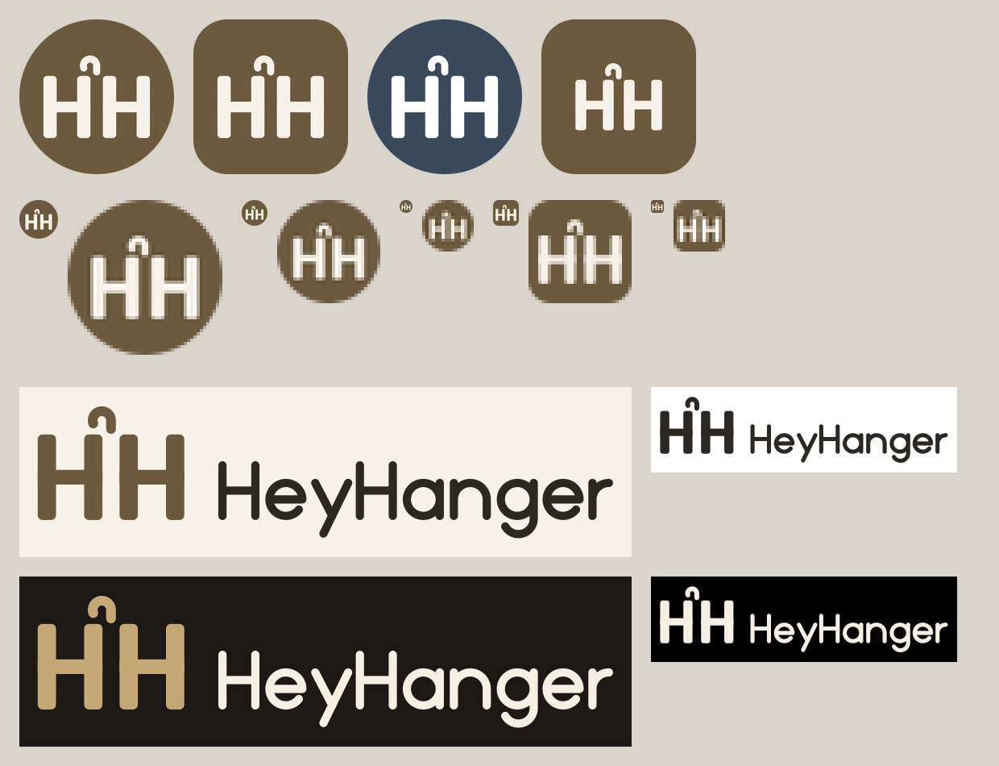

# HeyHanger branding reference

HeyHanger was called CLOSIQ until 2026-11-20.



The preview is generated from the exported files. Row 1 shows the Android adaptive icon under circle and rounded-square masks, the themed (monochrome) icon and the opaque app icon. Row 2 shows 48, 32 and 16 px renders next to 4× enlargements, followed by the browser favicon. Rows 3 and 4 show the lockups on light and dark surfaces.

## Names

| Use | Name |
| --- | --- |
| Product, project, Android launcher label | **HeyHanger** (both Hs capitalised, one word) |
| The assistant | **HeyHanger.ai** ("Ask HeyHanger.ai"). A display name chosen by the owner, not a web address: no heyhanger.ai domain is owned or linked. |
| Custom model family | **HeyHanger-VLM**; the planned 500M fashion checkpoint is **HeyHanger-VLM-500M** |
| Plain identifier / assistant slug | `heyhanger` / `heyhanger-ai` |

Personality: friendly, personal and easy to talk to. HeyHanger is the friend you ask, "What goes with this shirt?"

Renaming the custom model does not change its upstream base, training history, capabilities, licence or availability. No HeyHanger-VLM weights exist yet; the app runs the published base model under its own upstream name.

## The mark

The mark is an original **HH monogram**: two capital Hs with rounded corners. A small hanger hook rises from the gap between them. The hook is the only hanger cue and stays secondary. Stems are 60 units on a 280-unit cap height, crossbars are 48, the corner radius is 16, and the hook stroke is 32. The Hs stay separate, so the silhouette reads "HH" rather than a single H, an M or a fence. Use the gap between the Hs (56 units) as the minimum clear space around the mark.

The wordmark is original monoline lettering drawn from straight strokes and circular arcs with one 14-unit stroke and round caps and joins. Cap height is 100, x-height 70 and descender 30. No font file is used, so it renders identically everywhere. In the lockup, the HH letters stand on the wordmark baseline at 1.45× its cap height.

Keep the wordmark out of the small app icon.

## Colours

| Role | Hex | Token |
| --- | --- | --- |
| App icon tile, Android adaptive background, mark on light | `#6B5A3D` olive-brown | `--color-primary` |
| Mark on the icon tile, logo plate | `#F7F2E9` ivory | `--color-bg` |
| Wordmark on light, single-colour variant | `#2B2723` charcoal | `--color-text-primary` |
| Mark on dark | `#C6A876` gold-olive | dark `--color-primary` |
| Wordmark on dark, reversed single colour | `#F5EFE4` off-white | dark `--color-text-primary` |

Ivory on olive-brown has a contrast ratio of about 6:1, so the icon holds up on light and dark wallpapers.

UI type is unchanged. Playfair Display is used for headings and Plus Jakarta Sans for body text (`src/index.css`). The logo does not use either typeface.

## Files

Edit only the two masters, then regenerate:

```bash
node scripts/generate-app-icons.mjs
```

| File | Role |
| --- | --- |
| `public/brand/heyhanger-mark.svg` | **Master**: HH mark |
| `public/brand/heyhanger-wordmark.svg` | **Master**: wordmark |
| `public/brand/heyhanger-lockup.svg` / `-reversed.svg` | Full-colour lockup for light / dark surfaces |
| `public/brand/heyhanger-lockup-mono.svg` / `-mono-reversed.svg` | Single-colour lockup (charcoal / off-white) |
| `public/brand/heyhanger-mark-mono.svg` / `-reversed.svg` | Single-colour mark (charcoal / off-white) |
| `public/brand/heyhanger-app-icon.svg` | 1024 icon tile |
| `mobile/assets/app-icon.png` | `expo.icon` (opaque 1024 tile) |
| `mobile/assets/adaptive-icon-foreground.png` | Android adaptive foreground (mark inside the 66/108 safe zone) |
| `mobile/assets/adaptive-icon-monochrome.png` | Android 13+ themed icon |
| `mobile/assets/heyhanger-logo.png` | Native splash (`expo-splash-screen`), sign-in, Home header and launch intro |
| `public/favicon-32.png`, `public/apple-touch-icon.png` | Web favicon and home-screen icon (`index.html`) |
| `public/brand/heyhanger-app-icon-512.png` | 512 px icon for sharing |
| `public/brand/heyhanger-linkedin-square.png`, `heyhanger-linkedin-3x4.png` | Social images |
| `docs/brand/heyhanger-preview.png` | Review sheet (16/32/48 px, launcher masks, themed icon, lockups) |

Expo's prebuild turns `app-icon.png` and the adaptive layers into Android mipmaps. A changed icon reaches phones only through a new APK/AAB build. An OTA update cannot change it. The web uses `HeyHangerLogo` (`src/components/ui/HeyHangerLogo.tsx`), which places the light lockup on an ivory plate. `public/email-confirmed.html` does the same.

`mobile/assets/icon.png`, `splash-icon.png`, `android-icon-*.png` and `favicon.png` are unused Expo template placeholders. They contain no brand artwork.

## Identifiers that keep the old name

These are not shown to users and are kept for compatibility. Do not rename them without a migration plan.

- Android/iOS application ID `com.closiq.app`. It is installed on users' phones, so changing it would break in-place updates and leave wardrobes behind.
- Expo `slug` and `scheme` (`closiq`), the EAS project ID and the OTA update URL.
- Storage keys `@closiq_*` (mobile AsyncStorage) and `closiq_*` (web localStorage). Renaming them would make existing users' local caches and settings disappear.
- Calendar export UID domain `@closiq.app`. Re-imported events must keep their identity.
- Applied migrations `supabase/migrations/*closiq*`.
- External names: `https://closiq-liard.vercel.app`, the Vercel project `closiq`, the Supabase project "Closiq" and the GitHub repository `vudigapranav/CLOSIQ`.
